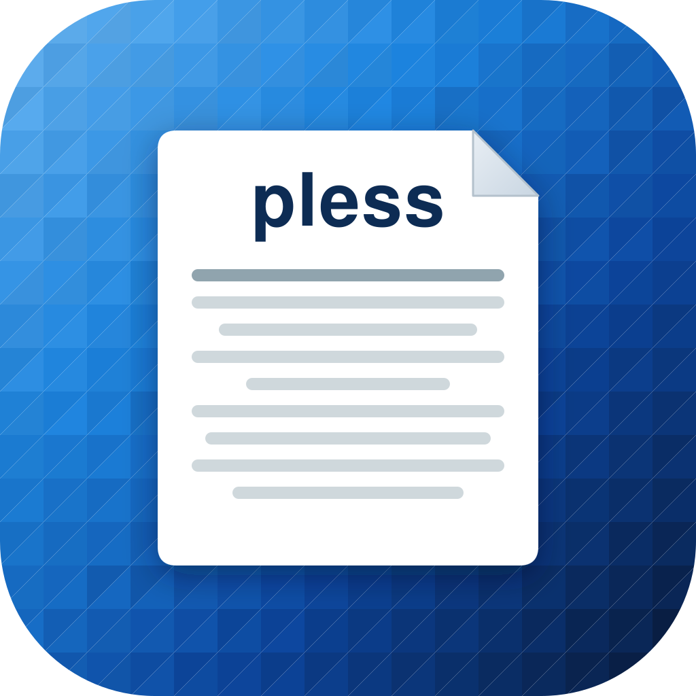

# pless



Deutsch: [README.md](README.md)

Native macOS app for local document management — Paperless, but local & native:
import PDFs, index them with on-device OCR, store them in one place with sensible
file names, search them, and connect them to a local AI via **MCP**.
No cloud, single user.

## What pless can do

- **Import:** PDFs via drag & drop, via “File > Import…” or automatically from the
  inbox (`inbox/`); duplicates are detected and moved to `_abgelehnt/`.
- **OCR & search:** text recognition directly on the Mac (Vision, de/en) and
  full-text search across title, OCR text and correspondent — all in one local database.
- **Storage & metadata:** PDFs land in `documents/YYYY/MM/` with names following a
  template (`{date}_{correspondent}_{title}.pdf`); edit title, date, correspondent,
  category, tags and notes conveniently in the app, plus thumbnails and a detail view.
- **Bilingual UI:** German and English, switchable in Settings → General —
  or “System”, in which case the operating system's language decides
  (applies immediately to the whole app UI).
- **AI connection:** own MCP server over stdio — a local AI can search/read documents,
  change metadata and assign tags (config below).
- **paperless-ngx sync (opt-in):** on request, push to a self-hosted paperless instance,
  including import of categories/correspondents and a cloud symbol per PDF —
  details in the [dedicated section](#paperless-ngx-sync-opt-in) below.

## paperless-ngx sync (opt-in)

On request, pless mirrors your documents to a self-hosted
[paperless-ngx](https://docs.paperless-ngx.com/) instance. Without a configured URL and
API token (Settings → paperless-ngx; the token is stored securely in the macOS keychain)
no network call is ever made.

**What the sync can do:**

- **Push:** new and changed PDFs are uploaded — with title, date, correspondent
  (→ paperless correspondent), category (→ paperless document type) and tags.
  Missing correspondents, document types and tags are created automatically in paperless.
- **Idempotent:** duplicate uploads are detected via checksum. If the file changes,
  it is re-uploaded; if only metadata changes (title, date, category …), the existing
  document in paperless is updated via PATCH — without re-uploading the file.
- **Force metadata:** via the dropdown on the sync button (toolbar) or the menu in the
  document details, metadata can be pushed again deliberately, e.g. to fix a wrongly
  assigned category.
- **Import from paperless:** all document types and correspondents of the paperless
  instance can be imported into pless as categories and correspondents (also via the
  sync dropdown).
- **Sync state per PDF:** every document card shows a cloud in the top right corner —
  green = synced, orange = pending (e.g. after a metadata change or a failed push),
  grey = unknown (sync not configured or never run). The same indicator is in the
  detail view.

Technical background (mapping, checksum, PATCH, pull): [docs/technik.en.md](docs/technik.en.md).

## Build & test (Xcode installed, SwiftPM only — no Xcode project needed)

```bash
swift build --package-path /Users/ptc/dev/ppless
swift run   --package-path /Users/ptc/dev/ppless PlessTests                # tests (exit code 0 = green)
swift run   --package-path /Users/ptc/dev/ppless Pless                       # app (GUI)
swift run   --package-path /Users/ptc/dev/ppless Pless --vault <path>        # app with another vault
swift run   --package-path /Users/ptc/dev/ppless Pless mcp --vault <path>    # MCP server (stdio)
```

## App bundle (.app)

```bash
bash Scripts/make-app.sh        # release build + bundle + signing → dist/Pless.app
open dist/Pless.app             # launch (or copy to /Applications)
```

`dist/` is not in git.

## Storage (vault)

Everything lives in one folder (default `~/Documents/Pless`, changeable in settings):
`pless.db` (local database), `documents/YYYY/MM/` (the PDFs), `inbox/` (import folder),
`thumbnails/` (cache). Details on layout and schema: [docs/technik.en.md](docs/technik.en.md).

## MCP connection (local AI, e.g. Claude Desktop)

`pless mcp --vault <path>` provides the AI with tools: search and read documents,
update metadata, assign tags, get statistics.

Config snippet (also copyable in the app settings under “MCP”):

```json
{
  "mcpServers": {
    "pless": {
      "command": "<path-to-binary>/Pless",
      "args": ["mcp", "--vault", "/Users/ptc/Documents/Pless"]
    }
  }
}
```

## Docs

- [docs/technik.en.md](docs/technik.en.md) — technical background: architecture, database schema
  and migrations, sync design (push/pull/PATCH), MCP protocol, tests, app bundle
- [docs/implementierung.en.md](docs/implementierung.en.md) — roadmap & progress log
- `AGENTS.md` — repo conventions (German)

## License

pless is open source under **GPL-3.0-or-later** — see [LICENSE](LICENSE)
(SPDX: `GPL-3.0-or-later`). **Forks are explicitly welcome**; changes to a fork
automatically fall under the same license. External commits/PRs are not accepted.

**Commercial license (dual licensing):** the author is the sole copyright holder and
offers a commercial license on request — for companies that want to use pless in
closed source or distribute it without source disclosure. Contact: dev@ptch.de

pless has no external dependencies: only Apple system frameworks (loaded dynamically
from macOS, not distributed with the app) and the system SQLite (public domain).

## Known limitations

- Share extension (Apple share sheet) is still missing — shared PDFs are placed in the
  inbox manually.
- No trash in the UI (soft delete is prepared in the schema).
- The paperless sync is a one-way push: changes made directly in paperless-ngx are not
  reflected back into pless.
- OCR: languages (de/en), accuracy (accurate/fast), language correction and resolution (dpi)
  are configurable in the settings — “accurate” + higher dpi recognize small print better.
