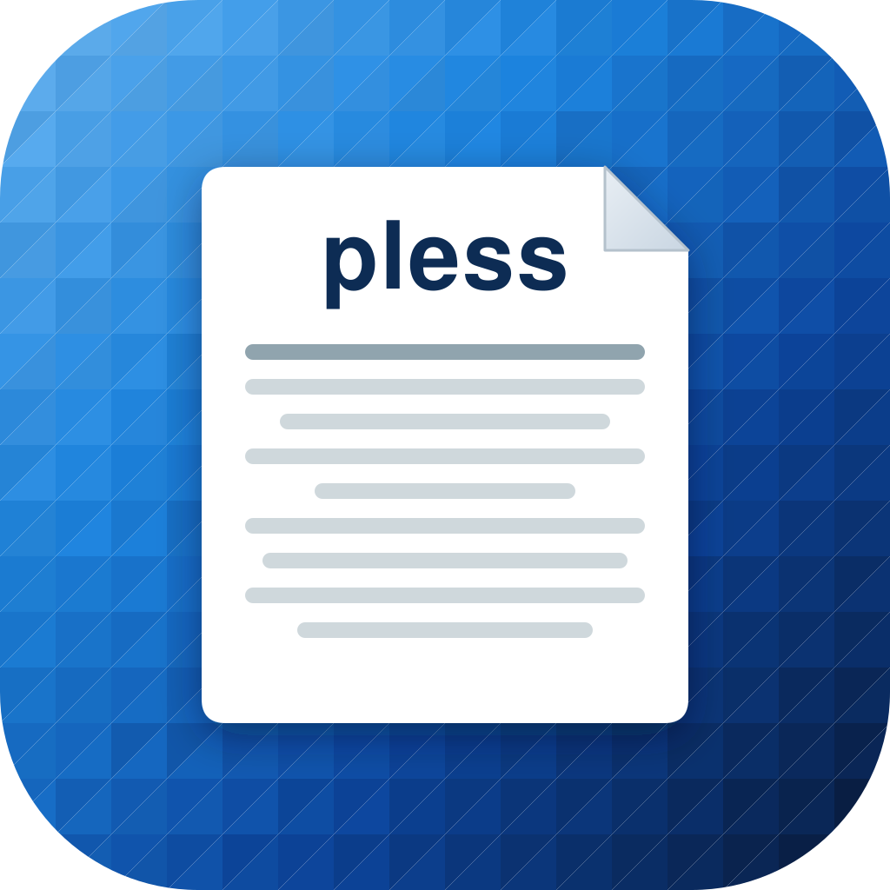

# pless



English version: [README.en.md](README.en.md)

Native macOS-App für lokales Dokumentenmanagement — Paperless, aber lokal & nativ:
PDFs importieren, per On-Device-OCR indizieren, an einem Ort ablegen, durchsuchen und
über **MCP** an eine lokale KI anbinden. Kein Cloud, Single User.

## Installation

Lade `Pless-macOS.zip` von [Releases](https://github.com/ptc/pless/releases/latest) und entpacke es.

**Hinweis zur Meldung „Pless ist beschädigt":** Die App ist ohne Apple-Zertifikat signiert, deshalb warnt macOS. Kein echter Schaden. Einmalig im Terminal ausführen:

```bash
xattr -cr /Applications/Pless.app
```

Selbst bauen (Xcode installiert, SwiftPM): `swift build --package-path /Users/ptc/dev/ppless`
— Details zu Tests, App-Bundle und MCP-Server in [docs/technik.md](docs/technik.md).

## Was pless kann

- **Import:** PDFs per Drag & Drop, über „Ablage > Importieren…“ oder automatisch aus dem Posteingang (`inbox/`); Duplikate landen in `_abgelehnt/`.
- **OCR & Suche:** Texterkennung direkt auf dem Mac (Vision, de/en) und Volltextsuche über Titel, OCR-Text und Korrespondent — alles in einer lokalen Datenbank.
- **Ablage & Metadaten:** PDFs landen in `documents/YYYY/MM/` mit Namen nach Schema (`{date}_{correspondent}_{title}.pdf`); Titel, Datum, Korrespondent, Kategorie, Tags und Notizen bequem in der App bearbeiten, dazu Thumbnails und Detailansicht.
- **Zweisprachige UI:** Deutsch und Englisch, umschaltbar in den Einstellungen.
- **KI-Anbindung:** eigener MCP-Server über stdio — eine lokale KI kann Dokumente suchen/lesen, Metadaten ändern und Tags zuweisen.
- **paperless-ngx Sync (opt-in):** Push zu einer selbst gehosteten paperless-Instanz, inkl. Import von Kategorien/Korrespondenten und Sync-Anzeige pro PDF.

## Technische Doku

Architektur, Vault-Layout, Datenbank-Schema, Sync-Design, MCP-Protokoll, Build & Tests,
App-Bundle, bekannte Einschränkungen: [docs/technik.md](docs/technik.md).
Roadmap & Fortschritts-Log: [docs/implementierung.md](docs/implementierung.md).

## Lizenz

pless ist Open Source unter **GPL-3.0-or-later** — siehe [LICENSE](LICENSE) (SPDX: `GPL-3.0-or-later`).
Forks sind ausdrücklich willkommen. **Benutzung auf eigene Gefahr:** privates Projekt im frühen
Entwicklungsstand (0.1.x), ohne jegliche Gewährleistung — Vault regelmäßig sichern.
